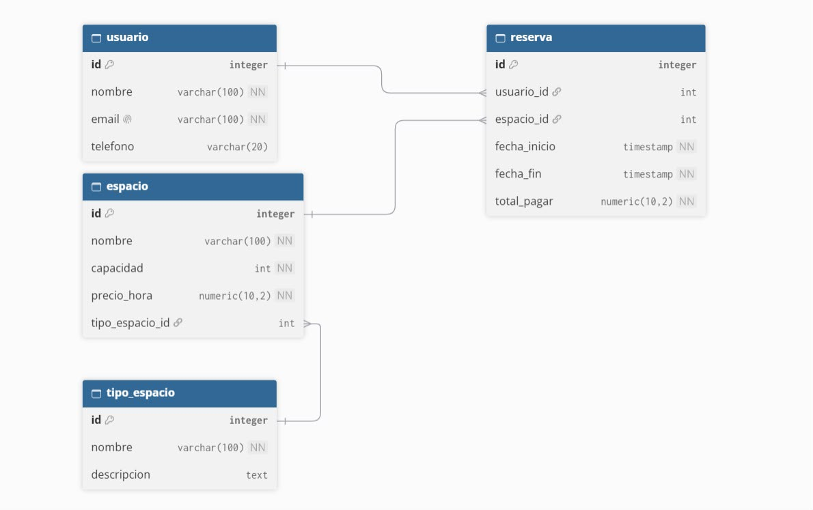

# Proyecto integrador B1-2026-2 G2

## Resumen Ejecutivo
Esta es una plataforma web para realizar la gestion los usuarios, recursos y reservas de un coworking.
Sirve para llevar un control de los regristros desde una interfaz grafica sencilla que se conecta directamente a la base de datos.

## Arquitectura 
El proyecto se divide en varias capas para mantener un orden que son las siguientes:
* Frontend: la interfaz visual.
* Backend: Toda la funcion de logica y servicios.
* Base de datos: Alamcenamiento y orden de datos entrantes en la plataforma web.

## Diagrama MER
A continuacion se muestra el modelo entidad-relacion de la base de datos

## Stack Tecnologico
* Lenguaje: Java.
* Framework Principal: Spring boot.
* Interfaz: Vaadin y CSS (Lumo).
* Gestor de paquetes: Maven.
* Base de datos relacional (SQL).
* Control de versiones: Git y GitHub.

## Guia de Configuracion local
Para poder correr el proyecto en tu computador de manera local, haz lo siguiente:  

### Pre-requisitos
Antes de empezar, asegúrate de tener instalado en tu computadora:
* Java (JDK 17 o superior).
* Git.
* Un gestor de base de datos local (como MySQL o PostgreSQL).

### Pasos de Despliegue Local

1. Descargar el código fuente
Abre una terminal y clona el repositorio del proyecto:
git clone https://github.com/restreport04-pixel/Proyecto-integrador-b1-2026-2-g2.git

2. Ingresar al directorio del proyecto
En la misma terminal, entra a la carpeta que se acaba de descargar:
cd Proyecto-integrador-b1-2026-2-g2

3. Preparar la base de datos
Abre tu programa de base de datos local (por ejemplo MySQL Workbench o pgAdmin) y crea una base de datos totalmente vacía. Puedes llamarla "coworking_db".

4. Configurar las variables de entorno (Conexión)
En Visual Studio Code, busca la carpeta src/main/resources/ y abre el archivo application.properties. Modifica las siguientes líneas para que el código se pueda conectar a tu base de datos:
spring.datasource.url=jdbc:mysql://localhost:3306/coworking_db
spring.datasource.username=tu_usuario_local
spring.datasource.password=tu_contrasena_local

5. Comandos de compilación y ejecución
Abre la terminal integrada en Visual Studio Code. Asegúrate de estar dentro de la carpeta del proyecto y ejecuta el archivo Maven Wrapper para encender el servidor:
- En computadoras con Windows, escribe:
.\mvnw.cmd spring-boot:run
- En computadoras con Mac o Linux, escribe:
./mvnw spring-boot:run

6. Acceder al sistema
Una vez que la consola deje de cargar y muestre que el sistema inició correctamente, abre tu navegador de internet e ingresa a:
http://localhost:8080

## Flujo de trabajo  
Para mantener el historial limpio, el equipo aplica las buenas practicas de "Conventional Commits".  
Todo el trabajo se realiza en ramas secundarias antes de unirse a la rama "Main".  

Es obligatorio usar los siguientes prefijos en cada commit:  
* feat: Para crear nuevas funcionalidades. (Ej: feat(reservas): agregar boton)
* fix: Para solucionar errores. (Ej: fix(login): corregir acceso)
* docs: Para documentacion. (Ej: docs(readme): actualizar texto)
* style: Para diseno. (Ej: style(ui): aplicar colores lumo)
   
## Licencia y creditos del equipo de trabajo  
Este proyecto se distribuye bajo los terminos especificados en el archivo LICENSE.md incluido en la raiz del  repositorio.  
* Integrante 1: Jacob Vanegas Martinez - Base de datos 
* Integrante 2: Thomas Restrepo Rodriguez - Frontend
* Integrante 3: Brenda Sofia Rivero Reyes - Documentacion
